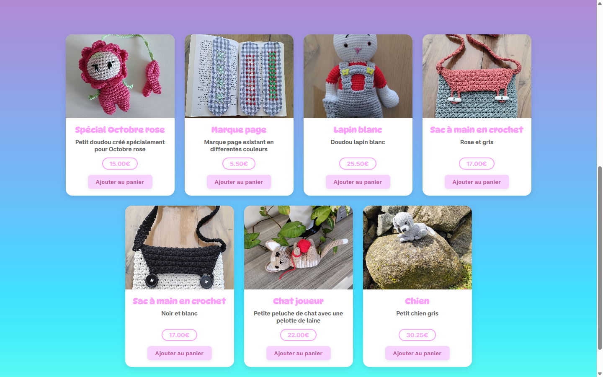
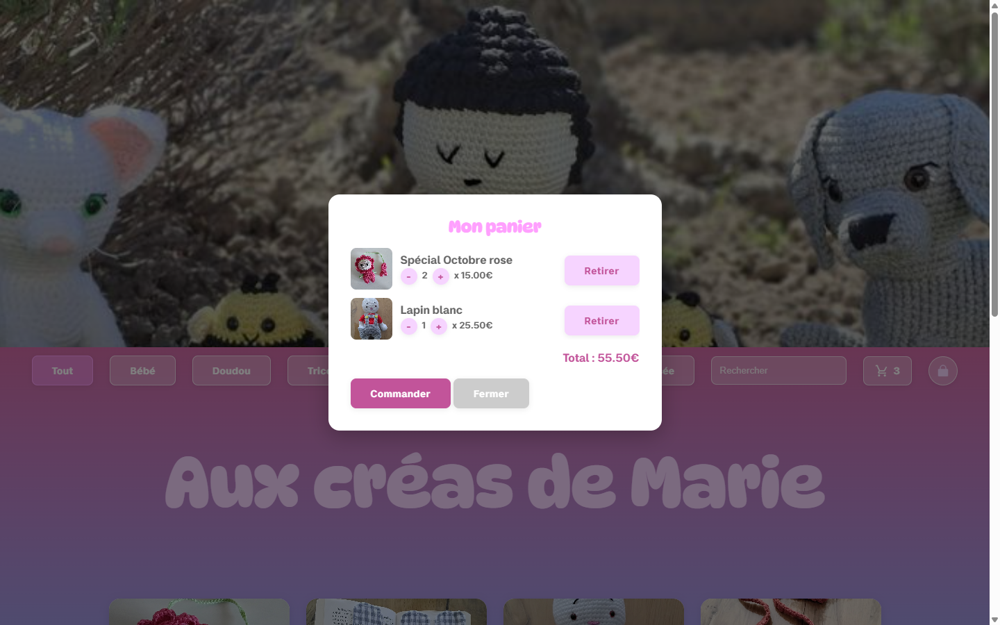
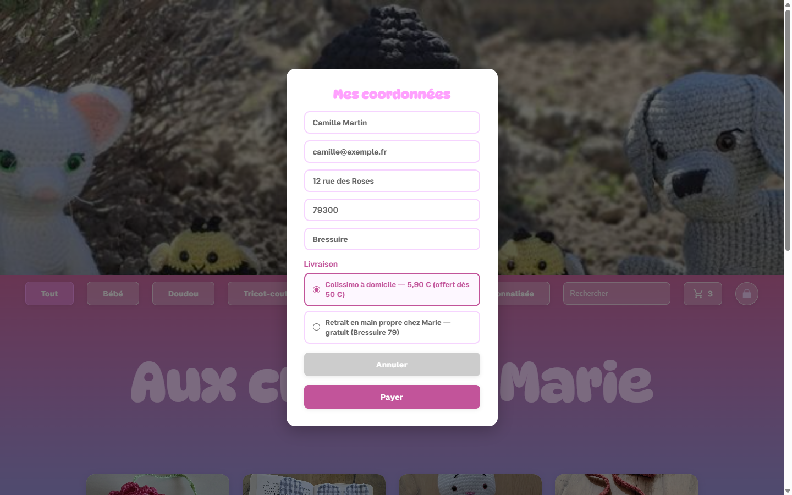
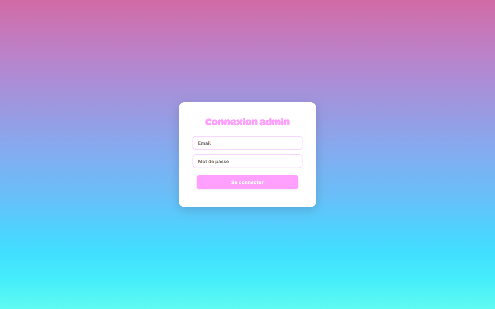
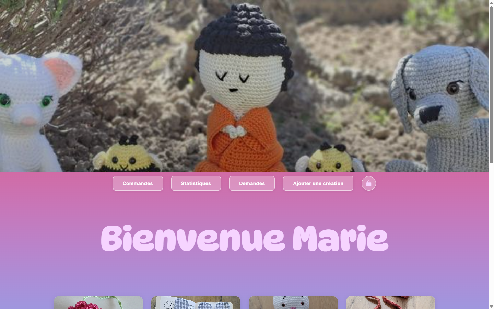
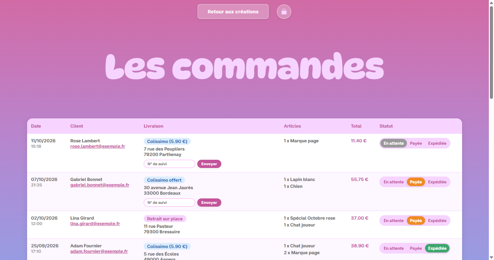
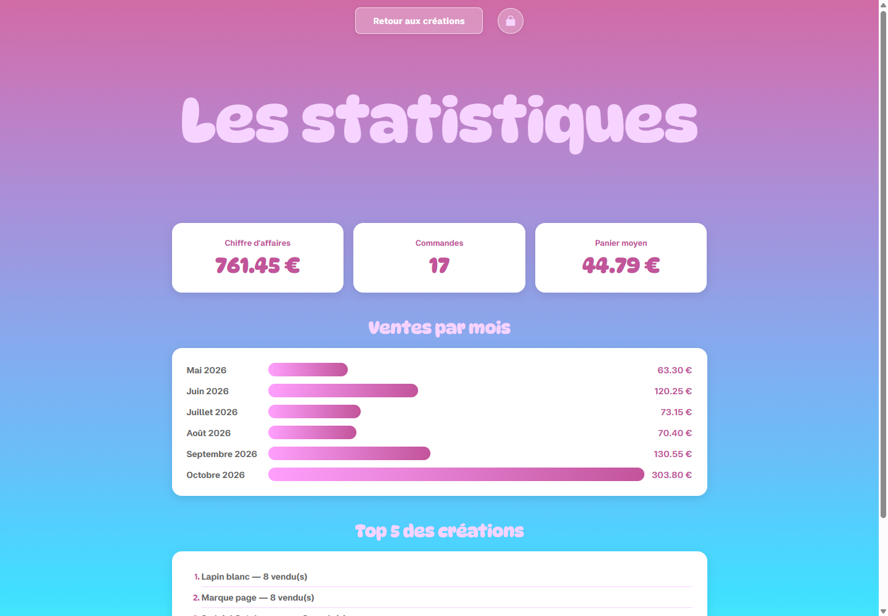

# 🧶 Aux créas de Marie

Site réalisé pour une amie afin de présenter et vendre ses créations artisanales faites main.

## Présentation

**Aux créas de Marie** a démarré comme un simple site vitrine, et est devenu un site e-commerce complet : catalogue, panier, paiement, livraison, suivi des colis et espace d'administration.

L'objectif est de proposer une boutique en ligne simple, chaleureuse et visuelle, permettant à Marie de gérer elle-même ses créations et ses commandes, et à sa clientèle de les découvrir et de les commander.

> **Site de démonstration** : le paiement fonctionne en **mode test Stripe** (aucun argent n'est prélevé), les emails sont capturés par Mailpit, et le site tourne en local (il n'est pas mis en ligne).

## Aperçu

**Site public**

| Accueil | Galerie |
|---|---|
|  |  |

| Panier | Commande et choix de la livraison |
|---|---|
|  |  |

| Mobile : menu burger | Mobile : bandeau cookies |
|---|---|
|  |  |

**Administration** (captures réalisées avec des commandes de démonstration)

| Connexion | Créations |
|---|---|
|  |  |

| Commandes et suivi des colis | Statistiques des ventes |
|---|---|
|  |  |

## Fonctionnalités

**Côté site public**
* Page d'accueil présentant l'univers de la créatrice, avec effet de parallax
* Galerie de créations, chargée dynamiquement depuis la base de données
* Recherche et filtre par catégorie
* Photos en grand dans une fenêtre (zoom au clic)
* Formulaire de demande personnalisée (avec photo d'exemple)
* Panier (ajout, + / −, suppression), gardé dans le navigateur
* Commande **sans compte client** : nom, email et adresse suffisent
* Choix de la livraison : Colissimo (5,90 €, offert dès 50 €) ou retrait en main propre
* Paiement par carte avec **Stripe Checkout** (mode test)
* Emails de confirmation de commande, et email avec le lien de suivi quand le colis part
* Bandeau cookies conforme CNIL : **Google Analytics n'est chargé qu'après « Accepter »**, choix modifiable à tout moment
* Pages légales : mentions légales, CGV, politique de confidentialité
* Interface responsive (menu burger sur tablette et mobile), vérifiée de 320 à 1920 px

**Côté administration (réservé à Marie)**
* Connexion sécurisée (sessions PHP, mots de passe hashés, déconnexion après 2 h d'inactivité)
* Ajout, modification et suppression des créations (avec image)
* Demandes personnalisées : liste, statut, suppression
* Commandes : liste, mode de livraison, statut (en attente / payée / expédiée)
* Numéro de suivi Colissimo : la commande passe en « Expédiée » et la personne qui a commandé reçoit le lien La Poste
* Bouton « Où est le colis ? » via l'**API Okapi de La Poste** (suivi de démonstration tant qu'aucune clé n'est configurée)
* Statistiques des ventes : chiffre d'affaires, nombre de commandes, panier moyen, ventes par mois, top 5 des créations

## Sécurité

* **Prix recalculés par le serveur** : le navigateur n'envoie que les identifiants et les quantités ; les prix et les frais de port viennent de la base de données (personne ne peut modifier le prix depuis son navigateur)
* **Paiement vérifié auprès de Stripe** avant de marquer une commande comme payée (et les emails ne partent qu'une seule fois)
* **Requêtes préparées PDO** partout (protection contre les injections SQL)
* **Transactions** : une commande et ses articles sont enregistrés ensemble, ou pas du tout
* **Protection XSS** : tout texte affiché passe par `escapeHtml` (ou `textContent`)
* **Pages et API admin protégées** par `admin_check.php`
* **Clés secrètes** (Stripe, Okapi, SMTP) rangées dans `Back/.env`, jamais envoyé sur GitHub
* Erreurs PHP écrites dans les journaux, jamais affichées aux visiteurs

## Technologies utilisées

* **HTML5 / CSS3 / JavaScript** (sans framework) — structure, mise en forme responsive, interactions (`fetch`, `<dialog>`, `localStorage`)
* **PHP 8.2** — logique serveur et API JSON
* **MySQL 8** — base de données
* **Composer** — bibliothèques PHP : PHPMailer (emails), stripe-php (paiement)
* **Stripe Checkout** — paiement en ligne (mode test)
* **API Okapi de La Poste** — suivi des colis Colissimo
* **Google Analytics 4** — mesure d'audience, avec consentement
* **Docker / Docker Compose** — environnement de développement (PHP + Apache, MySQL, phpMyAdmin, Mailpit)
* **Git / GitHub** — gestion et versionnement du projet

## Structure du projet

```text
Aux-cr-as-de-Marie/
│
├── Front/                          # Tout ce qui s'affiche dans le navigateur
│   ├── site.html                   # Site public (galerie, panier, commande, demande personnalisée)
│   ├── order_success.html          # Page "Merci pour votre commande" (retour de Stripe)
│   ├── mentions-legales.html / cgv.html / confidentialite.html   # Pages légales
│   ├── login.html                  # Connexion admin
│   ├── admin.html                  # Admin : les créations
│   ├── orders.html                 # Admin : les commandes et le suivi des colis
│   ├── requests.html               # Admin : les demandes personnalisées
│   ├── stats.html                  # Admin : les statistiques des ventes
│   ├── css/site.css                # Styles
│   ├── js/site.js                  # Galerie, recherche, filtres, parallax, burger, panier, commande
│   ├── js/cookies.js               # Bandeau cookies + chargement de Google Analytics après accord
│   ├── js/order_success.js         # Vérifie le paiement et vide le panier
│   ├── js/admin.js / orders.js / requests.js / stats.js / login.js   # Pages admin
│   ├── js/utils.js                 # Outils partagés (escapeHtml)
│   └── media/                      # Images statiques du site (fond, favicon...)
│
├── Back/                           # Serveur, API et base de données
│   ├── docker-compose.yml          # Services : mysql, phpmyadmin, php, mailpit
│   ├── Dockerfile                  # Image PHP : pdo_mysql, Composer, heure de Paris, pas de cache en dev
│   ├── composer.json               # Bibliothèques PHP (PHPMailer, stripe-php)
│   ├── .env.example                # Modèle des réglages secrets (à copier en .env)
│   ├── init.sql                    # Création des tables (au premier démarrage de MySQL)
│   ├── docs/create_admin.txt       # Script ponctuel pour créer le premier compte admin
│   ├── api/                        # API PHP, appelée par le front via /api/...
│   │   ├── config.php              # Connexion à la base de données
│   │   ├── mailer.php              # Prépare l'envoi d'emails (PHPMailer)
│   │   ├── login.php / logout.php / session.php / start_session.php / admin_check.php   # Connexion admin
│   │   ├── cards.php / add_card.php / edit_card.php / delete_card.php                    # Créations
│   │   ├── add_request.php / requests.php / update_requests_status.php / delete_request.php   # Demandes
│   │   ├── create_order.php        # Vérifie le panier, calcule le total + livraison, crée la page Stripe
│   │   ├── confirm_order.php       # Vérifie le paiement chez Stripe, envoie les emails
│   │   ├── orders.php / update_order_status.php       # Commandes (admin)
│   │   ├── update_order_tracking.php   # Numéro de suivi + email de suivi
│   │   ├── track_order.php         # Suivi du colis (API Okapi, ou démo sans clé)
│   │   └── stats.php               # Statistiques des ventes
│   └── uploads/                    # Images des créations et des demandes
│
└── README.md
```

## Base de données

| Table | Contenu |
|---|---|
| `cards` | les créations (nom, description, prix, catégorie, image) |
| `admin_users` | les comptes admin (mot de passe hashé) |
| `custom_requests` | les demandes personnalisées |
| `orders` | les commandes (nom, email, adresse, livraison, total, statut, numéro de suivi, session Stripe) |
| `order_items` | les articles de chaque commande (nom et prix **au moment de l'achat**) |

## Installation

Le projet tourne via Docker. Prérequis : [Docker](https://www.docker.com/) installé.

```bash
git clone https://github.com/Alliiissonnee/Aux-cr-as-de-Marie.git
cd Aux-cr-as-de-Marie/Back
cp .env.example .env      # puis remplir les réglages (voir ci-dessous)
docker compose up -d --build
```

Dans `Back/.env` :
* `STRIPE_SECRET_KEY` : la clé **de test** Stripe (`sk_test_…`), à copier depuis le tableau de bord Stripe → Développeurs → Clés API
* `OKAPI_KEY` : la clé de l'API Okapi de La Poste (demande un SIRET). **Laisser vide** pour un suivi de démonstration
* les réglages email peuvent rester tels quels : les emails sont capturés par Mailpit

| Adresse | Service |
|---|---|
| [localhost:8000/site.html](http://localhost:8000/site.html) | le site |
| [localhost:8000/login.html](http://localhost:8000/login.html) | la connexion admin |
| [localhost:8082](http://localhost:8082) | phpMyAdmin (identifiants dans `docker-compose.yml`) |
| [localhost:8025](http://localhost:8025) | Mailpit (les emails envoyés par le site) |

Les tables sont créées automatiquement à partir de `Back/init.sql` au premier démarrage. Pour créer le premier compte admin, adapter l'email/mot de passe dans `Back/docs/create_admin.txt` puis exécuter son contenu.

**Tester un paiement** : utiliser la carte de test Stripe `4242 4242 4242 4242`, une date future et n'importe quel code à 3 chiffres.

## Contexte du projet

Ce site est développé dans le cadre d'un **projet personnel**, à la demande d'une amie souhaitant vendre ses créations en ligne.

Ce projet me permet de travailler notamment sur :

* la conception d'une interface adaptée à un besoin réel ;
* le développement front-end (HTML, CSS, JavaScript) et back-end (PHP, MySQL) ;
* la mise en place d'une authentification et d'un espace d'administration ;
* la consommation d'une API JSON maison depuis le front (fetch, rendu dynamique) ;
* l'intégration d'API externes (Stripe, La Poste Okapi, Google Analytics) ;
* la sécurité d'un site marchand (prix calculés côté serveur, requêtes préparées, XSS, secrets) ;
* le respect du RGPD (consentement aux cookies, pages légales) ;
* l'utilisation de Docker pour un environnement de développement reproductible.
